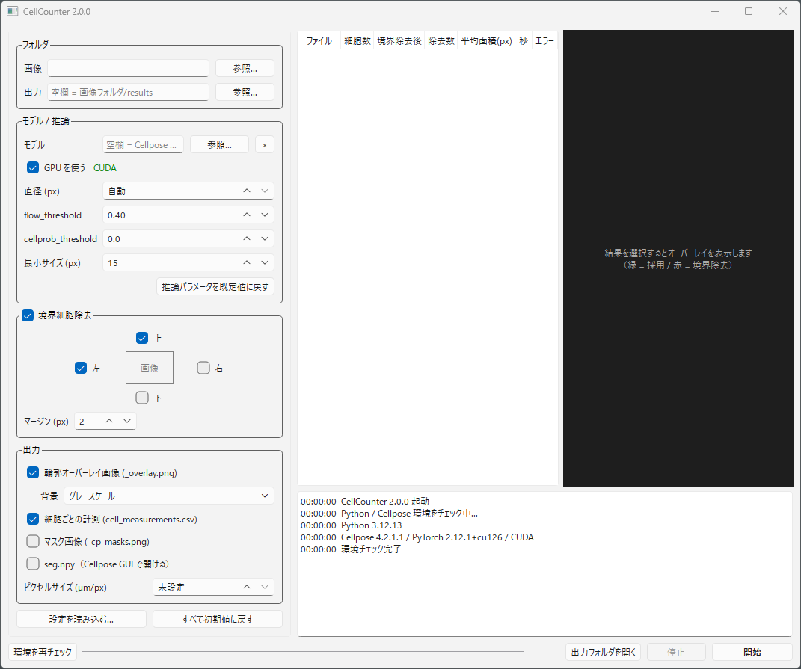

# CellCounter 2

Cellpose で顕微鏡画像の細胞をセグメンテーションし、フォルダ単位で **カウント・境界細胞除去・細胞ごとの計測・輪郭オーバーレイ・CSV 出力** を行うツールです。
GUI（PySide6）とコマンドライン（CLI）の両方から同じ解析エンジンを使えます。

## v1（C# / WPF 版）から変わったこと

v1 は C# の GUI から **画像 1 枚ごとに Python を起動し、毎回 Cellpose モデルを読み込み直して** いました。Cellpose‑SAM のモデルは大きいので、解析時間の多くがこの読み込みに費やされていました。そもそも解析本体（Cellpose / PyTorch / NumPy）は Python で動いているため、v2 では **すべてを Python に統一** しました。

| | v1 (C# + Python) | v2 (Python) |
|---|---|---|
| モデル読み込み | 画像ごと | **バッチ開始時に 1 回だけ** |
| 日本語（全角）パス | 不可 | **対応** |
| 構成 | C# ↔ JSON ↔ Python、Python 自動検出、タイムアウト | Python パッケージ 1 つ |
| 結果の確認 | ファイルを開いて確認 | **GUI 内で結果一覧とオーバーレイをプレビュー** |
| 計測 | 細胞数のみ | 細胞数＋**細胞ごとの面積・重心・平均輝度** |
| 推論パラメータ | モデルのみ | 直径・flow / cellprob しきい値・最小サイズ |
| 途中停止 | 即停止（結果 CSV は最後にまとめて保存） | 「停止」で現在の画像の後に止める、「強制停止」で即停止。どちらでも **処理済みの結果は CSV に残る** |
| 再現性 | settings.json（設定のみ） | settings.json に設定＋Cellpose/PyTorch のバージョン＋実行デバイス＋結果概要。**読み込んで同じ条件で再実行可能** |
| バッチ自動化 | 不可 | `cellcounter run` で CLI から実行可能 |

以下の不具合も修正しています。

- RGBA 画像で R チャンネルを捨てて A を使っていた
- オーバーレイが最大値で正規化されていたため、明るい画素が 1 つあるだけで全体が暗くなっていた（パーセンタイルで正規化するように変更）
- 輪郭抽出を細胞ごとに全画素ループしていて遅かった（ベクトル化）
- `seg.npy` の保存先ファイル名が壊れる可能性があった
- 入力フォルダと出力フォルダが同じとき、再実行するとオーバーレイ画像まで解析対象になっていた
- 警告が stderr に出ただけでエラー扱いになっていた

---

## セットアップ

既に v1 で使っていた Cellpose 環境（conda の `cellpose` 環境など）があれば、PySide6 を追加するだけで使えます。

```bat
conda activate cellpose
pip install PySide6
```

あとは `CellCounter.bat` をダブルクリックすると GUI が起動します。`.venv` → conda の `cellpose` 環境 → `py` → `python` の順に調べ、**Cellpose と PySide6 の両方が入っている** 最初の Python で起動します（足りない環境は `[skip]` と表示して飛ばします）。

起動しない・すぐ閉じる場合は、コマンドプロンプトで `CellCounter.bat debug` を実行するとエラー内容が表示されます。

### 新しく環境を作る場合

```bat
cd CellCounter
python -m venv .venv
.venv\Scripts\activate
pip install -e .
rem NVIDIA GPU を使う場合は CUDA 版 PyTorch に入れ替える
pip uninstall -y torch
pip install torch torchvision --index-url https://download.pytorch.org/whl/cu126
```

`pip install -e .` を行うと `cellcounter`（CLI）と `cellcounter-gui`（GUI）のコマンドも使えるようになります。

環境チェック:

```bat
python -m cellcounter info
```

---

## GUI の使い方



1. **画像フォルダ** を指定します（フォルダをウィンドウにドラッグ＆ドロップしても指定できます）。
2. 必要に応じて **出力フォルダ** を指定します（空欄なら `画像フォルダ/results`）。
3. モデル・推論パラメータ・境界細胞除去・出力を設定します（設定は次回起動時にも残ります）。
4. **開始** を押します。結果は 1 枚ずつ一覧に追加され、選択した画像のオーバーレイが右側に表示されます（ダブルクリックで原寸表示）。
5. **停止** を押すと、処理中の画像が終わったところで止まります。もう一度押すと **強制停止** します。

「設定を読み込む…」から以前の出力フォルダの `settings.json` を選ぶと、そのときと同じ条件を復元できます。「推論パラメータを既定値に戻す」は直径・flow_threshold・cellprob_threshold・正規化・niter・最小サイズだけを、「すべて初期値に戻す」はフォルダ以外のすべての設定を既定値に戻します。

GUI の前回の設定は、このフォルダ直下の `gui_settings.json` に保存されます（Git の管理対象外）。AppData などフォルダの外には何も書き込まないので、フォルダを削除すれば完全に消えます。

### 設定項目

| 項目 | 既定値 | 説明 |
|---|---|---|
| モデル | 空欄 | 空欄なら Cellpose の既定モデル（v4 では Cellpose‑SAM）。学習済みのカスタムモデルも指定できます |
| GPU を使う | ON | CUDA / Apple MPS が使えない環境では自動的に CPU で実行します |
| 直径 (px) | 自動 | 細胞の大きさの目安。Cellpose‑SAM では通常は自動のままで構いません |
| flow_threshold | 0.4 | 大きくすると検出数が増えます（形の崩れたマスクも許容されます） |
| cellprob_threshold | 0.0 | 小さくすると暗い細胞も検出されます（-6〜6） |
| 正規化 (パーセンタイル) | 1.0 〜 99.0 | この範囲の明るさを 0〜1 に揃えてから推論します（Cellpose GUI の norm percentiles）。明るいゴミや死細胞が多い画像では上限を下げると改善することがあります |
| niter | 自動 | 輪郭を作る計算の反復回数（Cellpose GUI の niter dynamics）。細長い細胞で輪郭が途切れる・1 つの細胞が分割される場合は 2000 などに増やします |
| 最小サイズ (px) | 15 | 面積がこのピクセル数より小さいマスクを除去します（Cellpose の `min_size`。Cellpose GUI には表示されず 15 固定）。小さなゴミが細胞として数えられる場合は上げます |
| 境界細胞除去 | ON（上・左） | 指定した端から「マージン」px 以内にかかる細胞を除外します。上・左だけを除外する方式は、視野をまたいで同じ細胞を二重に数えないための計数枠の考え方です |
| マージン (px) | 2 | Cellpose は端から 1〜2px 内側に輪郭を作るため、2 を推奨します |
| オーバーレイの背景 | グレースケール | 「元の色」も選べます。位相差・明視野はグレースケールのほうが輪郭が見やすく、蛍光など色に意味がある画像は「元の色」が向いています（CLI では `--overlay-background color`） |
| ピクセルサイズ | 未設定 | 設定すると面積を µm² でも出力します |

---

## CLI の使い方

```bat
cellcounter run D:\data\exp01                       :: 出力は D:\data\exp01\results
cellcounter run D:\data\exp01 D:\out --edges top,left --edge-margin 2
cellcounter run D:\data\exp02 --config D:\data\exp01\results\settings.json   :: exp01 と同じ条件で実行
cellcounter run D:\data\exp01 --cpu --no-overlay --save-masks --pixel-size 0.325
cellcounter run D:\data\exp01 --norm-percentile 1 98 --niter 2000         :: 正規化と niter を指定
```

`pip install -e .` をしていない場合は `python -m cellcounter run ...` を使います（`src` を `PYTHONPATH` に追加してください）。
終了コードは、成功なら 0、一部の画像でエラーがあれば 2、致命的なエラーなら 1 です。

---

## 出力ファイル

| ファイル | 内容 |
|---|---|
| `image_summary.csv` | 画像ごとの集計（下記）。1 枚処理するたびに追記されます。v1 の `cells.csv` に相当（列名も同じ） |
| `cell_measurements.csv` | 細胞ごとの計測（下記） |
| `{name}_overlay.png` | 輪郭オーバーレイ。**緑 = 採用 / 赤 = 境界除去** |
| `{name}_cp_masks.png` | ラベル画像（16bit。65535 個を超える場合は `.tif`） |
| `{name}_seg.npy` | Cellpose GUI で開ける形式 |
| `settings.json` | 実行記録（設定、Cellpose / PyTorch のバージョン、デバイス、開始・終了時刻、状態、件数） |

`image_summary.csv` が Excel で開かれていて書き込めないときは、`image_summary_YYYYMMDD_HHMMSS.csv` という名前で保存します。CSV は UTF‑8（BOM 付き）なので、Excel で開いても日本語のファイル名が文字化けしません。

### image_summary.csv（画像ごとの集計）

| 列 | 内容 |
|---|---|
| FileName | 画像ファイル名 |
| CellCount | Cellpose が検出した細胞数 |
| FilteredCellCount | 境界細胞を除去したあとの細胞数（v1 と同じ列名） |
| EdgeRemovedCount | 境界細胞として除去した数 |
| MeanArea_px / MedianArea_px | 採用した細胞の面積の平均・中央値 |
| Seconds | 処理時間 |
| Error | エラーの内容（正常なら空欄） |

### cell_measurements.csv

`FileName, Label, Area_px, Area_um2, CentroidY, CentroidX, MeanIntensity, EdgeRemoved`
（Label は `_cp_masks` のラベル番号に対応します。EdgeRemoved が 1 の行は境界除去された細胞です）

---

## 構成

```
CellCounter/
├── CellCounter.bat          GUI ランチャー
├── pyproject.toml
├── src/cellcounter/
│   ├── analysis.py          境界除去・計測・輪郭・オーバーレイ（numpy のみ）
│   ├── imagefile.py         画像の読み書き（Unicode パス対応）
│   ├── segmenter.py         Cellpose ラッパー・環境チェック
│   ├── pipeline.py          バッチ処理本体（GUI と CLI で共通）
│   ├── config.py            設定（dataclass ⇔ JSON）
│   ├── cli.py               cellcounter run / info / gui
│   └── gui/
│       ├── app.py           PySide6 GUI
│       └── worker.py        解析用の子プロセス（GUI が固まらず、即時停止も可能）
└── tests/test_core.py       Cellpose 不要のテスト（スタブモデルで処理全体を確認）
```

テスト: `python -m pytest` または `python tests/test_core.py`

## リリース手順（開発者向け）

バージョンは `src/cellcounter/__init__.py` の `__version__` の 1 か所で管理しています（`pyproject.toml` はここから読み取ります）。

1. `__version__` を新しい番号（例: `"2.0.1"`）に変更してコミット
2. 同じ番号のタグを付けて push（例: `git tag v2.0.1` → `git push origin v2.0.1`）
3. GitHub Actions がテスト後に Releases へ zip とリリースノートを公開します。タグと `__version__` が一致しないときは中止されます

## 注意

- 対応している画像は 2D の tif / png / jpg / bmp（グレースケール・RGB・2ch）です。Z スタックとタイムラプスには対応していません。
- Cellpose のライセンスにも従ってください。

## ライセンス

MIT — 開発: BPSE-Lab
